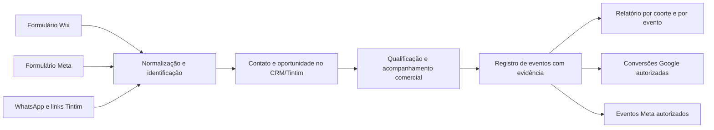

# Vésper — conexão e melhoria da integração com o Tintim

Plano técnico separado do relatório de anúncios, segmentação, landing page e comercial. Referência: consultas de 17/11/2026. **Nenhuma integração, etapa, webhook, conversão ou campanha foi alterada por este trabalho.**

## 1. O que existe e o que falta validar

| Componente | Evidência atual | Trabalho proposto |
|---|---|---|
| Acesso de leitura ao Tintim | Exportação de conversas e consulta de histórico de origem realizadas | Usar esse acesso para auditoria; ele não comprova disponibilidade de webhooks ou escrita |
| Google Ads | Conta [telefone omitido]; ação Contato Tintim com uploads, conversões otimizadas habilitadas | Identificar o produtor dos eventos, contrato de envio, deduplicação e retorno das etapas comerciais |
| Meta Ads | Conta act_1414897602023671, acessível pelo Stract | Auditar o fluxo dos formulários e se há retorno do CRM; isso não foi confirmado |
| Landing page | Wix, formulário e link de WhatsApp/Tintim | Validar captura de origem e pós-envio em ambiente de teste, sem gerar leads falsos em produção |
| HubSpot | Códigos, datas e origens nas listas fornecidas | Confirmar os IDs reais das oportunidades e como se relacionam aos contatos e conversas |
| Desfechos comerciais | Pedidos/perdas documentados no texto nem sempre equivalem ao estágio/valor do Tintim | Definir contrato de eventos com o comercial e reconciliar casos com evidência |

As credenciais privadas continuam nas configurações já existentes. Este documento não contém tokens e não propõe duplicá-los nos relatórios.

## 2. Por que a integração merece prioridade

- **Google:** 92 conversas na base; 29 têm ID/UTM numérica e quatro têm UTM textual que coincide com a campanha Search. Uma UTM ficou sem confirmação e 58 não têm campanha identificada. Os dois pedidos Google desta base não têm campanha identificada.
- **Meta:** 25 conversas; 17 têm ID de anúncio e oito apenas o rótulo da origem. Dos três pedidos, um tem anúncio identificado. Duas conversas de fornecedores aparecem como Meta, sem ID de anúncio; não devem virar avaliação de aquisição paga.
- **Contagens de plataforma:** Google tem 248 ações de conversão; Meta tem 70 ações lead (61 formulário e nove pixel) e 11 ações de conversa iniciada. Esses números não são cadastros de pessoas únicas nem devem ser somados entre canais.
- **Comercial:** no primeiro recorte, um contato e um contato têm pedido documentado, apesar de valor zero/etapa sem equivalência direta a venda. Valor zero não prova ausência de pedido; também não autoriza inventar faturamento.

O objetivo é saber **qual oportunidade veio de qual origem, o que aconteceu com ela e quando**, com distinção entre fato confirmado e vínculo provável.

## 3. Fluxo proposto

Primeiro validar o fluxo existente. Só implementar o que estiver faltando, após descobrir os pontos reais de entrada, os recursos disponíveis e os responsáveis por cada sistema.

## 4. Modelo mínimo de dados

### Identidade e oportunidade

| Campo | Regra |
|---|---|
| `contact_id` | Identidade do contato no sistema de origem; diferente de oportunidade |
| `opportunity_id` | Chave estável da oportunidade; preferir o ID real do negócio no CRM |
| `tintim_lead_id` | ID da conversa/registro exportado do Tintim |
| `hubspot_deal_id` / `hubspot_code` | ID real e código fornecido; não usar apenas o prefixo como chave única |
| `identity_confidence` | Confirmado, provável ou pendente, com motivo e fonte |
| `created_at` / `cohort_month` | Data de criação e mês atribuído da oportunidade; não sobrescrever com a data da última mensagem |

Telefone normalizado ajuda a localizar, mas não é chave suficiente de oportunidade. **um contato e um contato são oportunidades diferentes**, conforme confirmação do usuário. Ana um contato e um contato também não podem ser fundidos apenas por repetirem um prefixo de código. Homônimos e aproximações de nome pedem revisão; não viram confirmação automática.

### Origem, anúncio e formulário

Preservar `source_raw`, `source_list`, `source_normalized`, `origin_confidence`, `contact_method`, `campaign_id`, `campaign_name`, `adset_id` ou `adgroup_id`, `ad_id`, `form_id`, `leadgen_id` quando disponível e UTMs brutas. Campos de clique suportados pelo fluxo vigente, como GCLID, devem ser capturados no ponto correto e tratados no armazenamento privado da integração.

- Não usar nome de campanha como substituto permanente do ID.
- Separar origem informada na lista, origem rastreada e eventos posteriores de origem. Manter histórico de toques em vez de sobrescrever a primeira origem silenciosamente.
- Por decisão do usuário, **Outras origens/unknown são agrupadas como Site** neste relatório. Manter o valor bruto para auditoria. **untracked continua Sem rastreio**; não deve ser convertido automaticamente em Site ou Google.
- Salvar a primeira entrada e reentradas. Um formulário novo de cliente antigo pode ser reativação, novo projeto ou duplicidade: o comercial precisa distinguir.
- Em Meta, vincular o registro de formulário ao `leadgen_id` e IDs de campanha/conjunto/anúncio recebidos pelo fluxo. Confirmar quais campos o conector entrega; não presumir que uma UTM de nome resolve todo o caminho.
- Em Google, revisar a UTM fixa da Search, hoje com `utm_term=Energia Solar` e nome antigo de campanha no sufixo. Planejar parâmetros dinâmicos compatíveis com o fluxo existente, preservando identificação automática e redirecionamentos.

Não publicar IDs de clique completos, dados de visitantes ou credenciais nos HTMLs/CSVs de análise. O relatório precisa de IDs de oportunidade/anúncio e indicadores de presença do rastreio.

### Estado comercial, perfil e evidência

| Campo | Conteúdo esperado |
|---|---|
| `outcome` | Pedido realizado, Avanço, Em negociação, Em aberto, Perdido ou Outro |
| `outcome_event_at` | Data do evento comercial comprovado; não necessariamente mês da coorte |
| `next_step` / `next_step_at` | Próxima ação e data combinada |
| `lost_reason` | Motivo primário declarado; silêncio não preenche automaticamente esse campo |
| `unfit` / `unfit_reason` | Incompatibilidade da demanda com o escopo, independente do desfecho |
| `demand_type` | Nova instalação, ampliação, híbrido/backup, suporte, fornecedor, assinatura, equipamento avulso etc. |
| `evidence_ref` | Mensagem/documento/registro comercial que sustenta o fato |
| `order_value` / `paid_value` | Valor contratado e valor recebido em campos diferentes, somente quando confirmados |
| `currency` | Moeda do valor, BRL quando aplicável |

Uma pessoa pode perder a negociação e ter perfil. Pode também ter demanda incompatível sem ter sido explicitamente perdida. Financiamento recusado, idade, imóvel alugado, sistema híbrido ou consumo atual baixo não são exclusões automáticas.

## 5. Definir os eventos com o comercial

| Evento de negócio | Condição mínima proposta |
|---|---|
| Solicitação recebida | Entrada válida e identificável; ainda sem equivalência a qualificação |
| Demanda atendível | Objetivo e local compatíveis, contexto do imóvel/consumo conhecido e intenção de avaliar instalação |
| Oportunidade qualificada | Critérios acordados com comercial/técnico e próximo passo aceito; não basta ausência de sem perfil |
| Proposta enviada | Registro da proposta e data |
| Pedido confirmado | Evidência de aceite/contrato conforme critério definido pela Vésper; não exigir quitação integral para reconhecer pedido |
| Perdido | Encerramento explícito com motivo ou motivo não informado, sem inventar causa |
| Sem perfil | Demanda incompatível documentada, com motivo separado |

O evento de oportunidade qualificada precisa de uma definição operacional simples, verificável e aplicada de forma consistente. Confirmar como as etapas atuais do Tintim/CRM representam isso antes de mapear ou criar novos estados.

## 6. Retorno ao Google Ads

1. Mapear o envio atual de **Contato Tintim**: gatilho, fonte, identidade, timestamp e regra de repetição.
2. Planejar ações distintas de qualificação e pedido confirmado, se ainda não existirem. Usar as capacidades vigentes da conta e da integração.
3. Validar os novos sinais inicialmente para observação, preservando as ações atuais até comprovar cobertura, consistência e volume.
4. Para uploads, conferir a ação de conversão, a identidade/captura suportada, data/hora com fuso e chave de deduplicação. Usar valor/currency somente quando houver valor de negócio confirmado; valor padrão 1 não é receita.
5. Verificar reabertura, cancelamento e correção de valor antes de automatizar ajustes. Não usar apenas o estágio atual para reconstruir toda a história.
6. Decidir com mídia qual evento será usado em lances após uma janela suficiente de validação; não trocar a meta automaticamente porque a conexão foi criada.

Referências: [leads qualificados e convertidos](https://support.google.com/google-ads/answer/11459091?hl=pt-BR), [conversões otimizadas para leads](https://support.google.com/google-ads/answer/11347292?hl=pt-BR)um contato

## 7. Retorno ao Meta

1. Identificar o caminho real de entrega dos formulários e quais IDs chegam ao CRM/WhatsApp.
2. Auditar se existe Conversions API para CRM ou outro retorno comercial. O objetivo `LEAD_GENERATION` observado não comprova sozinho presença ou ausência da integração.
3. Mapear as etapas de negócio aos eventos aceitos pela configuração/API vigente. Confirmar campos obrigatórios e correspondência de identidade no conector escolhido antes de desenvolver o payload.
4. Validar recebimento, qualidade de correspondência e deduplicação. Usar identificador estável do evento/oportunidade, sem duplicar a mesma etapa a cada atualização da conversa.
5. Conferir a divergência entre o campo de relatório `1d_view_7d_click` e a configuração retornada de clique de 1 dia; não chamar isso de erro sem validar os escopos no Gestor.
6. Avaliar disponibilidade e adequação da otimização para qualificação na conta. Não prometer melhoria de custo ou escalar verba com base em benchmark de terceiros.

Referência: [Meta Blueprint — qualidade de leads e sinais do CRM](https://www.facebookblueprint.com/student/activity/673383)um contato

## 8. Deduplicação e reconciliação

- Chave de evento proposta: `opportunity_id + tipo_evento + versão_do_fato`um contato Ela precisa permanecer igual em tentativas de reenvio do mesmo fato.
- Manter um registro de envios: identificador do evento, destino, data, resposta, tentativa, erro e correção. Repetição de tentativa não cria uma conversão nova.
- Não somar aliases do Meta: os 61 `leadgen_grouped` repetem os 61 de formulário neste recorte. Conversa iniciada e formulário também podem pertencer à mesma pessoa.
- Não somar Google e Meta como clientes distintos sem reconciliação de identidade e oportunidade.
- Separar relatório de **coorte de entrada**, **eventos ocorridos no mês** e **estado atual**um contato um contato entra em setembro e tem avanço contratual em novembro.
- Não reincluir os 35 registros sem conversa atribuída nem os possíveis repetidos pendentes na automação de resultados sem nova validação.

## 9. Validação antes de ativar o fluxo

Usar testes identificados e ambiente apropriado. Não disparar contato real, venda fictícia ou conversão de produção para provar a integração.

| Cenário | Resultado esperado |
|---|---|
| Formulário Wix com origem Google preservada | Mesma oportunidade, origem e identidade ao longo do envio e da conversa |
| Formulário Meta encaminhado ao WhatsApp | ID de formulário/anúncio ligado à oportunidade quando disponível |
| Mesma oportunidade enviada novamente | Reentrada registrada sem pedido duplicado |
| Duas oportunidades no mesmo telefone | Identidades/oportunidades preservadas conforme validação comercial |
| Fornecedor marcado como Meta | Conversa separada da aquisição de nova instalação, sem envio como oportunidade qualificada |
| Crédito recusado, mas demanda atendível | Objeção registrada sem marcar sem perfil automaticamente |
| Pedido sem campanha identificada | Pedido reconhecido no comercial, sem inventar atribuição paga |
| Perda com silêncio apenas | Continua em aberto, sem motivo presumido |
| Correção ou reabertura | Histórico preservado e política do destino aplicada |

## 10. Entrega por etapas e responsáveis

1. **Diagnóstico do fluxo — integração + mídia + comercial:** mapa dos pontos de captura, produtores de eventos, campos recebidos, responsáveis e regras atuais. Resultado: contrato de dados aprovado pela operação.
2. **Identidade e origem — integração:** persistência de IDs, histórico e deduplicação; relatório de exceções com vínculos prováveis separados. Resultado: entradas novas rastreáveis sem fusões indevidas.
3. **Estados de negócio — comercial + integração:** critérios e evidências, próximo passo, perfil e perda separados. Resultado: eventos consistentes para análise.
4. **Validação dos destinos — mídia + integração:** eventos de teste/observação, logs e reconciliação. Resultado: contagem explicável e sinal utilizável.
5. **Uso para otimização — mídia + comercial:** escolher a etapa e acompanhar custo por oportunidade/pedido com maturação. Resultado: decisão de verba baseada em cobertura e qualidade, sem presumir causalidade.

Indicadores de acompanhamento: cobertura de IDs nas novas entradas, oportunidades com próximo passo, proporção de vínculos prováveis, duplicidades, erros de envio, desfechos com evidência e divergências entre CRM, Tintim e plataformas.

## 11. Auditoria solicitada após os feedbacks de Mirele

Complemento de 17/11/2026. Plano de verificação; nenhuma integração foi alterada. Heloísa coordena o retorno conforme a reunião. Responsáveis técnicos e prazos operacionais precisam ser combinados.

### Reconciliação do cadastro e das etapas

1. Obter a exportação do HubSpot com ID do negócio/contato, criação, reentrada, etapa, responsável e histórico de mudanças. As listas recebidas não substituem esse histórico.
2. Conciliar outubro: mais de 100 cadastros segundo a cliente versus 89 conversas na base analítica. Explicar o universo de cada número. Os 35 sem conversa são exclusões de todos os meses; não presumir que expliquem a diferença de outubro.
3. Conferir um contato (100017), um contato (100103), um contato (100144), um contato (100223) e um contato Halfeld (100253): fato na conversa, data do fato, etapa HubSpot, data da mudança, etapa Tintim, data da atualização e evidência de envio/recebimento.
4. Validar equivalência entre nomes de etapa antes de corrigir registros. Não concluir alteração manual sem histórico/log que identifique a operação. Valores como `change_method` devem ser interpretados pela documentação do fornecedor, sem deduzir seu significado de uma letra isolada.
5. Separar atraso, falha, divergência de critério e intervenção manual. Conservar evidência e data de corte.
6. Manter coorte atribuída separada da data dos eventos: um contato é coorte setembro com pedido em novembro; um contato é coorte novembro com incompatibilidade/perda no histórico de agosto.

### Prova do retorno comercial à mídia

A auditoria encontrou **21 conversões na ação Contato Tintim** (5 Search e 16 PMax), não 21 qualificações. Isso não prova o produtor do evento, a ausência de duplicidades ou o envio de pedidos. Retorno das etapas comerciais à Meta não confirmado.

Para cada evento de contato, qualificação, proposta/visita e pedido, preencher:

| Campo de auditoria | Evidência exigida |
|---|---|
| Critério comercial | Definição aceita pela equipe; ausência de sem perfil não vale como qualificação |
| Origem do evento | Sistema produtor, gatilho e responsável técnico |
| Identidade | ID da oportunidade e vínculo de atribuição disponível; não apenas nome ou telefone |
| Cronologia | Data do fato, do registro, do envio e do recebimento |
| Confirmação | Log/diagnóstico de aceitação da plataforma, erros e última execução bem-sucedida |
| Duplicidade | Chave, regra de reenvio e prevenção de duplicação por mudança de etapa |
| Uso na mídia | Ação existente, primária/secundária, meta e seleção efetiva para otimização |
| Cobertura | Eventos comerciais elegíveis versus enviados, recebidos e atribuídos, no mesmo universo |

Começar por um caso real com histórico verificável, com escopo e autorização adequados para eventual envio. Não gerar leads fictícios em produção. Não importar novamente o histórico sem conferir duplicidade e janela de aceitação. Ajustar metas/lances somente após validar o fluxo e o volume, evitando tratar múltiplas etapas da mesma pessoa como oportunidades adicionais.

### Origem declarada e intenção

Acrescentar `discovery_source_reported`, `discovery_source_evidence`, `contact_reason_now`, `intent`, `intent_evidence`, `intent_confidence`, `next_action_owner` e `next_action_due_at` ao contrato proposto. Manter os campos rastreados separados.

- um contato (100045, m-16) relata indicação da um contato.
- um contato (100015, m-32) relata o modo IA do Google; não equivale a Google Ads.
- um contato (100072) tem histórico anterior à reativação. Não atribuir essa demanda histórica automaticamente à campanha ou mês da retomada.
- Intenção: instalação solar, instalação de carregador, informação sobre veículo, demanda combinada, assinatura, empréstimo sem projeto, suporte/fornecedor/outra natureza ou indefinido. Confirmar a fala e o serviço atendível; não inferir pela campanha.

### Acompanhamento dos testes comerciais

Identificar abordagem/variante, versão da proposta, data, coorte, origem, intenção, etapa, próximo passo e resultado. Os testes de personalização e PDF já foram relatados como em andamento, mas não têm eficácia demonstrada nesta análise. Leitura de PDF só deve ser registrada quando houver medição válida. Não inferir atendimento humano do primeiro registro de mensagem do provedor.

A aba Aproveitamento apresenta um indicador conservador de retorno com conteúdo textual, cuja regra está em `metodologia-aproveitamento.md`um contato Ele não substitui qualificação no HubSpot nem mede SLA humano.

Versão pública: identificação e transcrições mantidas somente no projeto interno.
